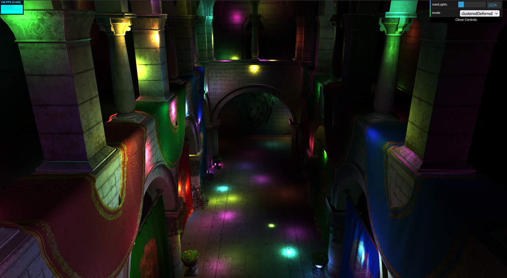
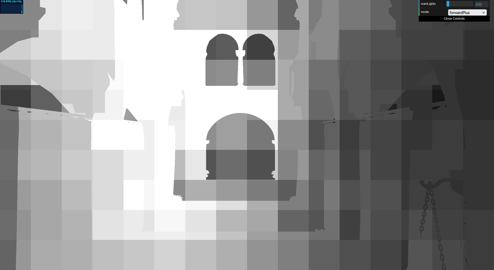
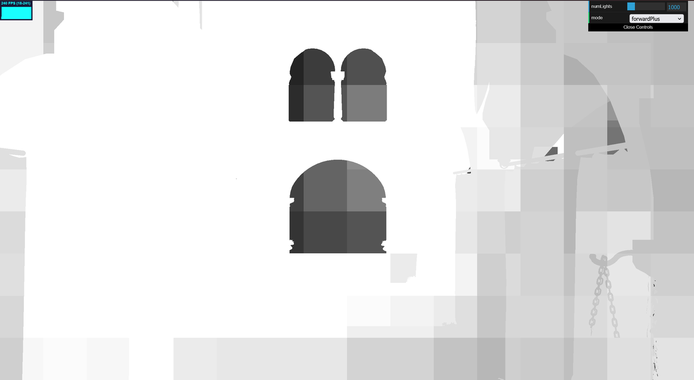
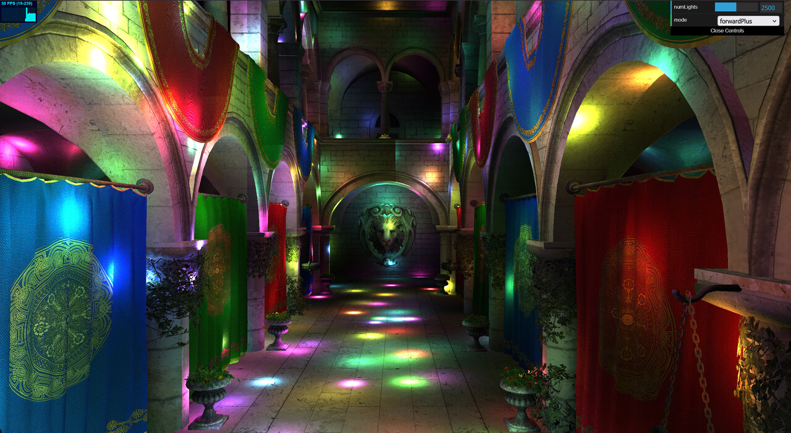
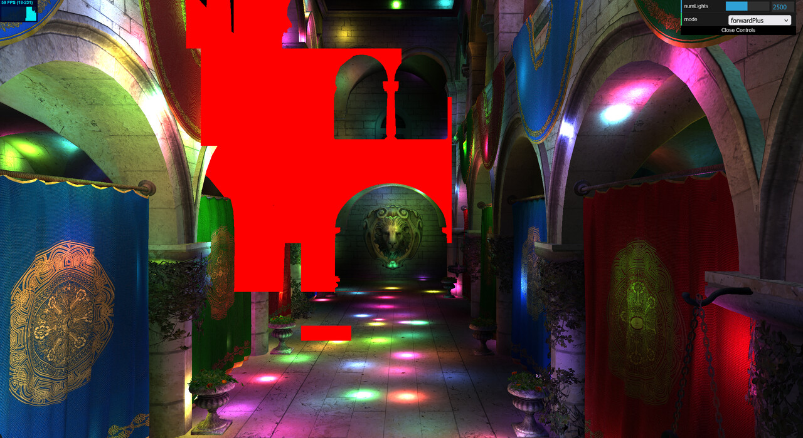
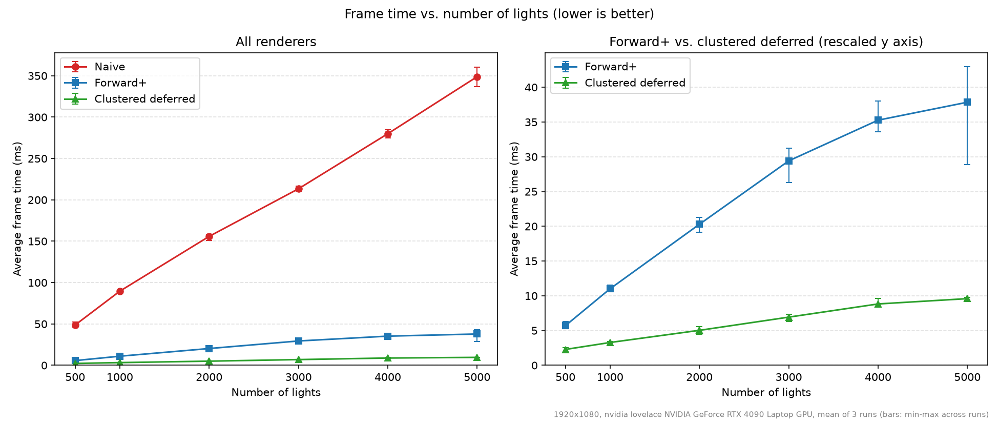
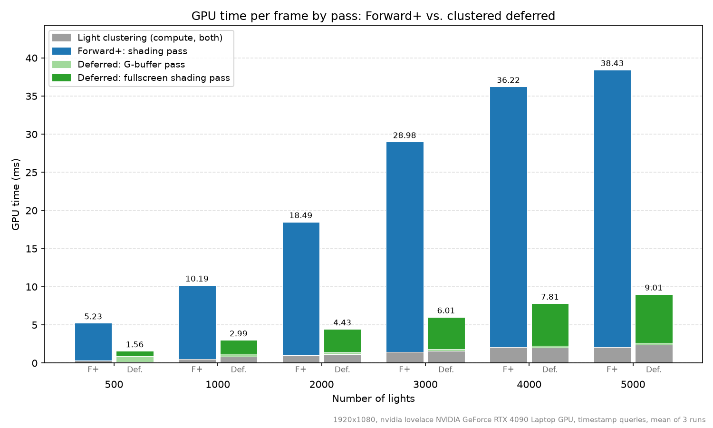
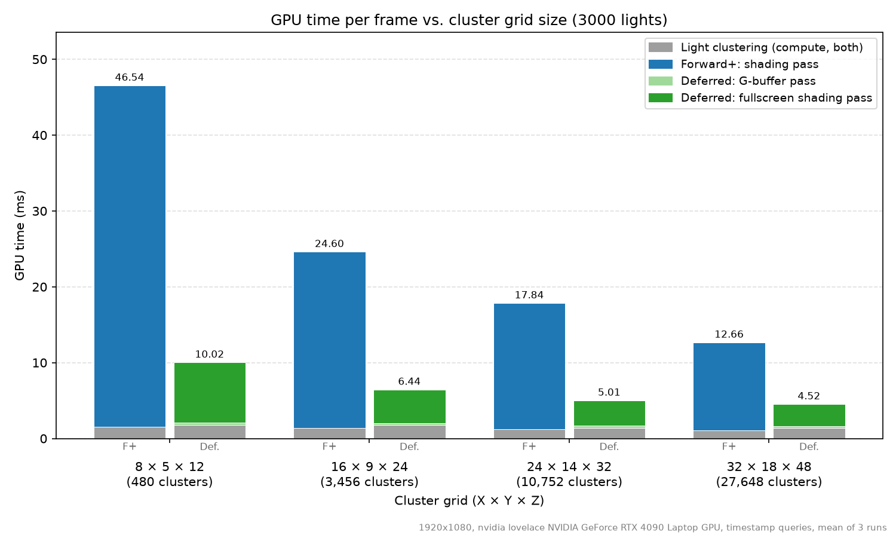
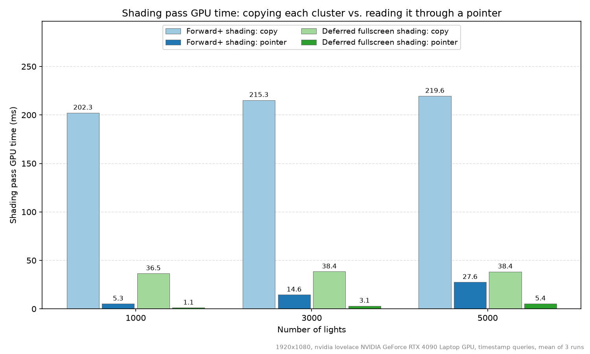

WebGPU Forward+ and Clustered Deferred Shading
======================

**University of Pennsylvania, CIS 565: GPU Programming and Architecture, Project 4**

* Stephen Gavin Sears
  * [LinkedIn](https://www.linkedin.com/in/gavin-sears-536a1b285), [personal website](https://gavinsears.dev)
* Tested on: Windows 11, i9-14900HX @ 2.20GHz 32GB, RTX 4090 Laptop 16GB, Compute Capability 8.9 (Personal Computer)

### Live Demo

*Click the image to open the live demo (requires a WebGPU-capable browser. Tested in Chrome and Firefox).*

### Demo Video

<!-- I'm gonna update this on github so it links properly -->
[Demo video (MP4)](img/demo.mp4)

### Overview

This project tests the performance of three different renderers implemented using WebGPU. The three types of renderers tested are:
- Naive
    - For each fragment in the scene, we loop over every light to calculate influence.
- Forward+
    - We divide the view frustum into clusters (I'm using exponential spacing for the z dimension), and check which lights intersect with the cluster's AABB. These lights are then the only ones we use in the fragment shader to determine lighting.
- Clustered Deferred
    - We calculate the clusters as before, but when we actually render, we split our rendering into a geometry pass and a lighting pass. The geometry pass renders albedo, normal, and depth into gbuffers. Once we have these textures, we then render a giant triangle that covers the screen. For this triangle's fragment shader, we use the depth gbuffer to recover the original world coordinates of the fragment, then use the normal gbuffer and the albedo gbuffer to calculate lighting. Since we have the world position, we can use the clusters like before to limit the number of lights we need to check per fragment.

As a side note, I assume the reader will probably readily understand why forward+ is generally considered more efficient, but maybe not why the deferred method is more efficient. The important thing to remember about fragment shaders is that a fragment is not a pixel, but more like a "potential pixel." This is to say that we do work for pixels on objects that may be hidden from view before we render the objects in front. When we do deferred rendering, we are taking only basic data from these hidden fragments like albedo and normal. This means that in our deferred pass, none of our actual lighting work will be done on hidden fragments.

### Features

- Naive forward renderer
- Forward+ renderer
- Clustered deferred renderer
- Some very basic debug views
- Timing tools

### Debug Views

#### Lights per cluster

<table>
  <tr>
    <td></td>
    <td></td>
  </tr>
  <tr>
    <td align="center">500 lights</td>
    <td align="center">1000 lights</td>
  </tr>
</table>

The clusters appear to be a 2d grid, but keep in mind that the grid extends to the z dimension as well (that is why you can still make out the shapes of the windows). The color intensity is based on the number of lights present in the cluster divided by 64. This means that white clusters have 64 or more lights, while the darker clusters have fewer than 64. Clusters closer to the center of the scene, where more lights often happen to be, tend to be brighter here, as you'd imagine. These lighter clusters end up being more intense to compute than the darker clusters.

#### Cluster light overflow (maxLightsPerCluster too small)

<table>
  <tr>
    <td width="75%"></td>
    <td width="25%"></td>
  </tr>
  <tr>
    <td align="center">Artifacts at 2500 lights and 256 light limit per cluster</td>
    <td align="center">Zoomed in</td>
  </tr>
</table>

One downside of the clustering technique, as I see it, is that adding too many lights can cause strange visual artifacts if you have not allowed for them in your shader. If you look closely at the larger image, you can see seams at the edges of clusters where one side is darker, and the other side is lighter. In particular, the zoomed in image shows an especially bad example of this, where it looks like the light was cut in half. 

This happens because the limit of lights per cluster was set too low. When the light limit is set too low, clusters will start ignoring additional lights after hitting the limit. That's why the green light in the zoomed in picture gets cut off. One of the clusters allowed for it in its limit, while the other ignored it, causing the strange artifact.

I made a simple but effective way to view which clusters are affected by this issue by setting the output color to red if the number of lights reaches maxLightsPerCluster (a shader constant that gets substituted into the shader source).

Raising maxLightsPerCluster to 1024 removed the artifacts in the views shown here and in most other situations I tested. The only downside of this is that it makes our cluster buffer 4x larger.

### Performance Analysis

1920x1080 canvas, RTX 4090 Laptop GPU, default camera position, and Chrome with vsync and the frame-rate cap disabled (by launching Chrome with --disable-gpu-vsync --disable-frame-rate-limit).

There are two main timing metrics I am using. This is what they mean:
- Frame time: Wall-clock time between consecutive frames. This includes all the code runtime and everything needed to present the image.
- GPU time: How long the GPU spent executing one specific pass. This is measured using timestamps the GPU writes at the start and end of the pass. The GPU time of a frame is the sum of its timed passes: the shading pass (plus the G-buffer pass for deferred), and for the clustered renderers, the light clustering compute pass. The light-movement compute pass is not timed.

Each configuration was run 3 times and interleaved with the other configurations to mitigate the impact of something like thermal throttling. Each run had a 1.5 s warmup, then the average timing over 4 seconds is recorded. The charts show the mean of 3 runs for each reading. The vertical error bars on the line chart show the range of these readings, since some configurations varied a bit between runs.

#### Forward+ vs. clustered deferred

More lights in the scene universally increases the frame time (lowers the FPS), but each algorithm slows down at a different rate. For naive, frame time grows much faster, appearing to have a linear relationship with the number of lights (fitting, since naive loops over every light for each fragment). For Forward+ and deferred, frame time grows much more slowly, and the curves flatten somewhat at the highest light counts. This is because splitting the rendering into clusters means each fragment only does lighting work for the lights in its own cluster, rather than for every light added to the scene. The light limit per cluster may also contribute to the flattening, since a cluster that hits the limit stops adding light calculations (even though it starts to show the visual artifacts described above. Just to be clear, I did not measure how many clusters reached the limit in these runs, but when testing, it does not appear to hit the limit too much. That being said, I think this is likely still impacting the performance in this way).

If we split each frame into passes, we can see where the differences in the Forward+ and Deferred methods come from. While the light clustering time is the same for each, and the gbuffer pass for deferred also has a very small cost, the shading/fragment stages are very different. Forward+ shades every fragment that passes the depth test at the moment it is drawn, even if something drawn later ends up covering it, while deferred shades only the pixels that are visible in the final image (take a look at my explanation of the algorithms in the overview), which makes it considerably more efficient.

Overall, Deferred is the better choice for when we have many lights. The cost we pay for this faster peroformance is a higher memory bandwidth due to writing and reading the gbuffer every frame. It should also be noted that transparency with the gbuffer would likely be an issue, so Forward+ is probably a better alternative if you are using scenes with that feature, so if you have fewer lights, that might be the better option.

#### Cluster grid size

At 3000 lights, finer grids (smaller clusters) give us better speed for both the Forward+ and Deferred rendering methods. This is because smaller clusters hold fewer lights, so each fragment has to do less work. However, memory usage goes up very quickly as clusters get smaller, so keeping the clusters somewhat large also helps if we want to conserve memory. Therefore, one of the most balanced options here is likely 16 x 9 x 24. Going from 8 x 5 x 12 to 16 x 9 x 24 gives the biggest single improvement, while each finer grid after that costs much more memory for a smaller gain.

#### Optimization: reading clusters through pointers instead of copying them

It is important to remember to access cluster data via pointers as opposed to copying the data directly into the fragment shader. This chart demonstrates how high of a performance cost this has. At 1000 lights, we go from 202.3 ms of shading to 5.3 ms for Forward+, and from 36.5 ms to 1.1 ms for the Deferred method. This is such a significant difference that it becomes more of an issue for performance than changing the number of lights in the scene (since as you can see, increasing the light number barely changes the performance in the versions that copy data, while it matters for the versions that use pointers). 

### Credits

- [Vite](https://vitejs.dev/)
- [loaders.gl](https://loaders.gl/)
- [dat.GUI](https://github.com/dataarts/dat.gui)
- [stats.js](https://github.com/mrdoob/stats.js)
- [wgpu-matrix](https://github.com/greggman/wgpu-matrix)
